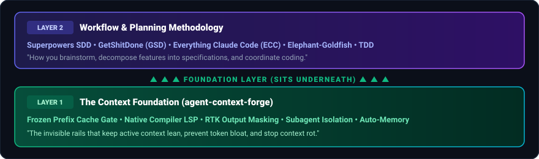
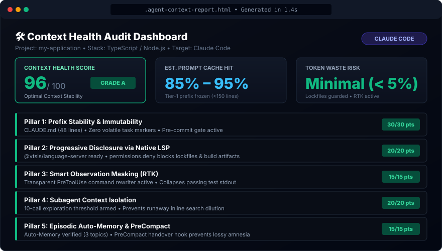

<div align="center">

# 🛠️ Agent Context Forge

**An open-source CLI auditor and context-engineering harness that stops AI coding agents from bloating their root rules, reading 80k-token lockfiles, and polluting their own context window.**

[](#the-5-pillars-under-the-hood)
[](#portability--roadmap)
[](#license)
[](LICENSE)
[](CONTRIBUTING.md)

</div>

---

## ⚡ Quickstart (One Command)

Run directly inside **any existing repository** (to audit context health) or an **empty directory** (to scaffold a new project):

```bash
npx agent-context-forge
```

<p align="center">
  
</p>

* **In an existing codebase:** Audits your repository across the 5 Pillars of Context Engineering in `< 2 seconds` and opens a self-contained, dark-mode **HTML Context Health Dashboard** in your browser.
* **In an empty folder (or when installing):** Launches an interactive stack wizard to configure native LSP symbol navigation, [`rtk`](https://github.com/rtk-ai/rtk) test output compression, runaway exploration guardrails, episodic memory, and optional SDD rules.

---

## 💥 Why AI Coding Agents Degrade Mid-Session

When an AI coding agent starts a session, it feels sharp. Thirty minutes later, it forgets architectural rules, hallucinates file paths, and burns through API limits.

The root cause rarely lies in the model weights—it is **unmanaged context entropy**:

| Failure Mode | What Happens by Default | How `agent-context-forge` Fixes It |
| :--- | :--- | :--- |
| **1. Root Context Bloat & Churn** | Sprint checklists (`- [ ]`), issue IDs (`#123`), and `TODO`s pile up in `CLAUDE.md`. That file is re-sent on every turn, so each stale line costs tokens and dilutes the rules that matter. (Each edit also costs one prompt-cache miss at the next session start, but caches expire within minutes to an hour anyway, so size and focus matter more.) | **Pillar 1 (Prefix Stability):** Enforces a frozen `< 150 line` Tier-1 prefix and blocks volatile state or broken path references via a pre-commit gate. |
| **2. Lockfile & Full-File Token Bombs** | Reading a lockfile, minified bundle, or source map whole loads up to 25,000 tokens of noise per call (Claude Code refuses files over 256 KB, so smaller ones are the risk). | **Pillar 2 (Progressive Disclosure):** Guides you to Claude Code's code intelligence plugin for your language (compiler-backed symbol lookups) + a hook that blocks only whole-file reads of those files, so grepping them still works. |
| **3. Test & Build Output Floods** | Running `pytest`, `vitest`, or `cargo test` dumps hundreds of passing test lines and ANSI codes into the context window. | **Pillar 3 (Observation Masking):** A `PreToolUse` hook hands every Bash command to [`rtk`](https://github.com/rtk-ai/rtk)'s own rewrite engine, which covers piped and chained commands too (`uv run pytest -q \| tail -40` → `uv run rtk pytest -q \| tail -40`), collapsing passing suites while keeping failures. |
| **4. Runaway Inline Exploration** | The primary agent executes 25+ consecutive `Grep`/`Read` calls inline, suffering *"lost-in-the-middle"* attention decay before writing a line of code. | **Pillar 4 (Context Isolation):** A lightweight Python state machine counts consecutive searches and reads in the primary session (including `grep`/`find` through Bash) and, every `15`, adds a non-blocking note suggesting a subagent. |
| **5. Lossy `/compact` Amnesia** | When the window fills up and `/compact` runs, default summarization strips away exact `file:line` pointers and active root-cause hypotheses. | **Pillar 5 (Episodic Memory):** Pairs two-tier Auto-Memory (`MEMORY.md` index + lazy topic files) with a `PreCompact` handover hook that feeds active git state and preservation rules into the compaction summary. |

---

## 🧠 Core Architecture: Context Window = RAM, Repo = Disk

Our guiding systems principle is simple:
* **Active Context Window = L1/RAM:** Finite, expensive, and prone to attention dilution. Keep it flat, static, and high-signal.
* **Repository, LSP & Memory = Disk:** Deep storage queried progressively on demand via symbol pointers and isolated subagents.

### The 2-Layer Stack: Harness vs. Methodology

`agent-context-forge` does **not** dictate how you brainstorm or plan features. It is the **Layer 1 infrastructure harness** that sits underneath your preferred **Layer 2 workflow**:

<p align="center">
  
</p>

---

## 🖥️ What the CLI & HTML Auditor Do

When you run `npx agent-context-forge`, it adapts to your directory:

```text
┌   🛠️  AGENT CONTEXT FORGE  v0.1.0 — Context Engineering Harness
│
◇  🔍 Existing project detected: /path/to/repo [TypeScript]
│
◆  What would you like to do?
│  ● ⚡ Scan & Generate HTML Context Audit Report (Recommended)
│  ○ 🚀 Install / Upgrade Context Forge Harness
│  ○ Exit
```

### 1. The 5-Pillar Context Audit & HTML Dashboard (`Scan` Mode)
Evaluates your repository offline in `< 2 seconds` and opens `.agent-context-report.html` in your default browser:

<p align="center">
  
</p>

* **Context Health Score (0–100 / Grade A–F)** + measured **Tier-1 size** (lines, ~tokens) and **Unprotected Lockfile Exposure** (~tokens one stray `Read` could load). The tool doesn't report cache hit rates or token savings it hasn't measured.
* **Exact `File:Line` Violations:** Pinpoints volatile markers (`TODO`, checkboxes, dates) and dead file paths inside `CLAUDE.md` / `AGENTS.md`.
* **Live Token-Bomb Exposure:** Scans the repo for unprotected lockfiles (`pnpm-lock.yaml`, `package-lock.json`, `Cargo.lock`) and calculates how many thousands of tokens an accidental `Read` will cost.
* **What the score measures:** how closely the repo follows the five pillars as this tool defines them. Treat it as a setup checklist, not a benchmark. A hook earns points only when it is wired in settings and its script exists, and equivalents count (rtk's own `rtk init -g` hook, any `PreCompact` or `SessionStart` `compact` hook). Two checks (16 points) look specifically for this harness's commit gate and exploration guardrail.
* **Interactive Remediation:** Offers to automatically install missing binaries (`rtk`, `typescript-language-server`, `pyright`) right from the terminal, and prints the code intelligence plugin to install for your language.

### 2. Modular Stack Configurator (`Install` Mode)
Lets you customize each layer instead of forcing a rigid template:
* **Progressive Disclosure:** Claude Native LSP *(default)* or bring your own code-intelligence MCP/tool.
* **Observation Masking:** [`rtk` (Rust Token Killer)](https://github.com/rtk-ai/rtk) *(default)* or custom output filter.
* **Subagent Isolation:** Exploration Guardrail note after 15 consecutive searches *(default)*, Orchestrator Tool Permission Scoping (`.claude/agents/orchestrator.md`, whose `tools` allowlist leaves out `Edit`/`Write`), or both.
* **Episodic Memory:** Built-in Claude Auto-Memory *(default, zero setup)* or [`context-mode`](https://github.com/mksglu/context-mode) *(sandboxed FTS5/BM25 MCP virtualization)*.
* **SDD Pairing (Optional):** Pre-wires rules for [Superpowers SDD](https://github.com/obra/superpowers), [GetShitDone (GSD)](https://github.com/open-gsd/gsd-core), [ECC](https://github.com/affaan-m/everything-claude-code), or the [Elephant-Goldfish Model](https://github.com/google/elephant-goldfish-model).
* **Custom Context Bootstrapping (Optional):** Describe what you're building right in the CLI to generate a tailored, prefix-stable `CLAUDE.md`, `AGENTS.md`, and `.agents/rules/project-architecture.md`.
* **Lean `CLAUDE.md`:** The `CLAUDE.md` the harness writes holds only rules that change how Claude works (your stack and constraints, a references rule for the LSP tool, and grepping lockfiles), because every line is sent with every request. Guidance for you sits in an HTML comment, which Claude Code strips before loading the file. When your repo already has an `AGENTS.md`, the new `CLAUDE.md` imports it with `@AGENTS.md`, since Claude Code reads only `CLAUDE.md` when both exist.
* **Safe on existing repos:** Install never discards your configuration. `.claude/settings.json` is merged (your permissions and hooks are kept, and a `.bak` copy is saved first). Your `CLAUDE.md`, `AGENTS.md`, agents, rules, and git hooks are replaced only while they are unchanged since the last install. Once you have edited one (or wrote it yourself), it is kept, and the harness version is written next to it as `<file>.context-forge-new` for you to merge.

---

## 🔧 The 5 Pillars Under the Hood (Latency & Hook Mechanics)

A common question with agent hooks is: *"Do these hooks slow down every tool call or burn extra tokens?"*

**Almost never.** Every hook has a **zero-token deterministic fast path**. The one exception is the commit gate below, which calls a model only when a commit touches your agent context files:

### Pillar 1: Hybrid Pre-Commit Prefix Stability Gate
* **File:** [`.claude/hooks/pre-commit-prefix-stability.sh`](.claude/hooks/pre-commit-prefix-stability.sh) + [`.githooks/pre-commit`](.githooks/pre-commit)
* **Fast Filter (`< 2ms`, `0 tokens`):** Every non-commit `Bash` command exits `0` immediately via a shell regex check, and so does every `git commit` while `CLAUDE.md`, `AGENTS.md`, `.claude/`, and `.agents/` have no pending changes.
* **Commit Audit (not free, not local):** When a commit does touch those paths, a headless read-only evaluation (`claude -p --model haiku`) runs under your Claude Code login. It sends your context files and diff to the model and uses tokens. It verifies:
  1. `CLAUDE.md` / `AGENTS.md` stays `< 150 lines` (`~1,000 tokens`).
  2. Zero volatile task state (no checkboxes, issue IDs, or deadlines).
  3. Zero duplicate rules between Tier 1 (`CLAUDE.md`) and Tier 2 (`.claude/agents/`, `.claude/skills/`).
  4. Every referenced file path and script actually exists in the repository.

### Pillar 2: Progressive Disclosure via LSP & Whole-File Read Guard
* **Files:** [`.claude/hooks/guard-whole-file-reads.sh`](.claude/hooks/guard-whole-file-reads.sh) + [`scripts/agent-gates/check-lsp.sh`](scripts/agent-gates/check-lsp.sh)
* **Mechanism:** Claude Code's `LSP` tool (go to definition, find references, diagnostics after edits) stays off until you install a [code intelligence plugin](https://code.claude.com/docs/en/plugins/code-intelligence) for your language, and a language server on `PATH` is not enough on its own. The doctor and scanner check that the plugin is installed for the project folder (e.g. `claude plugin install typescript-lsp@claude-plugins-official`), not just enabled in settings, and that the binary it starts can run. For TypeScript that means `npm install -g typescript-language-server typescript@6`: TypeScript 7 no longer ships the `tsserver.js` the server needs.
* **References rule:** The generated `CLAUDE.md` asks Claude to use the `LSP` tool's references lookup for "who calls X" questions. Left to itself, Claude almost always reaches for grep, which conflates same-named symbols and misses aliased imports.
* **Whole-File Read Guard:** A `PreToolUse` hook on `Read` blocks reading lockfiles, minified bundles, and source maps whole, and tells Claude to grep them or read a range instead. It replaces `permissions.deny` Read rules, which also block every Grep and `grep` of those files and made agents fail questions like "which version is locked". Upgrading from v0.1 removes the deny rules it added.

### Pillar 3: Transparent Observation Masking (`rtk`)
* **File:** [`.claude/hooks/rewrite-rtk.sh`](.claude/hooks/rewrite-rtk.sh) + [`scripts/agent-gates/check-rtk.sh`](scripts/agent-gates/check-rtk.sh)
* **Mechanism:** Passes each Bash command to `rtk hook claude`, rtk's own rewrite engine, through Claude Code's `updatedInput` protocol. Agents usually trim output themselves (`2>&1 | tail -40`), so a hook that skipped piped commands never fired; rtk rewrites the first stage of such pipelines and each part of `&&` chains. If `rtk` is not installed on `PATH`, the hook exits `0` in `< 1ms`.
* **Safety:** `python -m pytest` is left alone, because rtk would run whichever `pytest` is first on `PATH`. rtk refuses to rewrite commands with file redirects or `$(...)`. The project settings set `RTK_SUPPRESS_HOOK_WARNING=1`, since rtk's "no hook installed" notice only looks at global settings.
* **No auto-approval:** rtk approves a rewrite only when your own allow rules already match the command, and leaves deny rules to Claude Code. Commands like `npm test` run arbitrary project code, so otherwise your normal permission prompt applies.
* **rtk's own hook:** rtk ships a Claude Code hook of its own (`rtk init -g`). When it is configured, this hook stands down so commands are not rewritten twice. Install rtk with `brew install rtk` (or see [its install guide](https://github.com/rtk-ai/rtk#installation)), not `cargo install`: a different crate named `rtk` exists on crates.io.

### Pillar 4: Subagent Context Isolation
* **Files:** [`.claude/hooks/guard-subagent-isolation.py`](.claude/hooks/guard-subagent-isolation.py) + [`.claude/agents/orchestrator.md`](.claude/agents/orchestrator.md)
* **Mechanism:** Tracks consecutive `Read`, `Grep`, and `Glob` calls, plus Bash commands that only search or read (`grep`, `rg`, `find`, `cat`, `sed -n`, ...), per session in `/tmp/agent_context_forge/`. Claude Code searches through Bash by default on macOS and Linux. Calls made inside subagents (hook input carries an `agent_id`) are not counted.
* **Threshold:** Calls `1–14` pass silently (`< 5ms`, `0 tokens`). On call `15`, it adds a note (`additionalContext`) suggesting a subagent, without blocking the call, then re-arms for the next `15`. Denying the call only cost a retry in benchmarks, and agents did not delegate in response. Resets when `Agent`, `Write`, or `Edit` is called.

### Pillar 5: Episodic Memory & Lossy Compaction Handover
* **Files:** [`.claude/hooks/pre-compact-handover.sh`](.claude/hooks/pre-compact-handover.sh) + [`scripts/agent-gates/check-memory.sh`](scripts/agent-gates/check-memory.sh)
* **Mechanism:** Verifies Claude Code's native two-tier Auto-Memory (`~/.claude/projects/<slug>/memory/MEMORY.md`) on `SessionStart`, and triggers on `PreCompact` to print `git status -s` + `git diff --stat` and preservation rules. Claude Code uses a PreCompact hook's stdout as instructions for the compaction summary.

### Session Start: Project Facts
* **File:** [`scripts/agent-gates/session-context.sh`](scripts/agent-gates/session-context.sh)
* **Mechanism:** Gives Claude a few stable facts that save discovery turns, such as how this project runs its tests (`uv run pytest`, `pnpm test`, `go test ./...`) and that `sed -i` needs `''` on macOS. Agents otherwise spent several turns trying `python`, `python3`, and finally `uv run`. Warnings from the environment doctor (missing rtk, language server, or plugin) go to you as a message instead of into Claude's context. The facts contain no paths, dates, or counts, so the prompt prefix stays identical across sessions and caches well.

---

## 🧩 Pairing with SDD & Planning Methodologies

Because `agent-context-forge` operates strictly at **Layer 1 (The Context Harness)**, it pairs cleanly with any **Layer 2** engineering methodology:

1. **[Superpowers SDD](https://github.com/obra/superpowers) (`obra/superpowers`):** Superpowers dispatches fresh subagents per task for TDD/code-review loops. With this harness underneath, every spawned subagent automatically inherits LSP symbol navigation, `rtk` test compression, and lockfile protection.
2. **[GetShitDone — GSD](https://github.com/open-gsd/gsd-core) (`open-gsd/gsd-core`) & [Everything Claude Code — ECC](https://github.com/affaan-m/everything-claude-code) (`affaan-m/everything-claude-code`):** GSD and ECC enforce spec-driven phase loops and context compartmentalization; `agent-context-forge` ensures their workers don't leak raw stdout noise or dirty the root prefix cache.
3. **[The Elephant-Goldfish Model](https://github.com/google/elephant-goldfish-model) (`google/elephant-goldfish-model`):** Keeps long-term architectural knowledge with the **Elephant** on disk while enforcing stateless, zero-bias **Goldfish** subagents in working RAM.
4. **Classic TDD or Interactive Pair Programming:** Prefer no framework at all? The harness works invisibly in the background while you code normally.

---

## 🌐 Portability & Roadmap

While all hooks are production-ready for **Claude Code** and **Universal Git** today, the core gates (`scripts/agent-gates/`) are written in portable POSIX shell and Python so they can be adapted across runtimes:

| Agent / Runtime | Integration Mechanism | Status |
| :--- | :--- | :--- |
| **Claude Code** | Native `SessionStart`, `PreToolUse` & `PreCompact` hooks in `.claude/settings.json` | ✅ **Production Ready** |
| **Universal Git (CLI / IDEs)** | Standard Git pre-commit wrapper in `.githooks/pre-commit` | ✅ **Production Ready** |
| **Gemini CLI / Antigravity** | `.agents/rules/` + Tool Execution Policy adapters | 🚧 [Issue #1](https://github.com/Soufraz/agent-context-forge/issues/1) |
| **OpenCode / Aider** | `AGENTS.md` + `.agents/` universal standard | 🚧 [Issue #1](https://github.com/Soufraz/agent-context-forge/issues/1) |
| **Multi-LSP & Compressor Adapters** | Pluggable LSP & output masking alternatives beyond the official LSP plugins / `rtk` | 🚧 [Issue #2](https://github.com/Soufraz/agent-context-forge/issues/2), [Issue #3](https://github.com/Soufraz/agent-context-forge/issues/3) |

---

## 🧪 Running the Self-Test Suite

The repository includes both Node.js unit tests (for the CLI, scaffolder, 5-Pillar scanner, and HTML generator) and shell integration tests (for all hook state machines and fast-filters):

```bash
git clone https://github.com/Soufraz/agent-context-forge.git
cd agent-context-forge
npm install
npm test
```

---

## 💖 Standing on the Shoulders of Giants & Fair-Use Attribution

### The Philosophy: Proven Solutions, One Cohesive Foundation
We did not reinvent the wheel, nor do we claim to have discovered revolutionary new neural algorithms. The pain points of unmanaged context—prompt cache thrashing, token bloat from lockfiles, test output pollution, and runaway inline exploration—are felt by engineers and AI researchers every day.

Brilliant creators across the open-source community have built focused, high-impact utilities and methodologies to address individual facets of this challenge.

**Agent Context Forge** exists to synthesize these proven open-source solutions into a clean, reproducible, and standardized **Layer-1 boilerplate generator and health auditor**. It gives developers a solid context-engineering foundation in under 10 seconds, eliminating hours of manual configuration, trial-and-error, and expensive token burn.

### Deep Gratitude to the Open-Source Ecosystem
We extend our deepest respect and fair-use attribution to the creators whose tools, research, and ideas made this project possible:

* **[`rtk` (Rust Token Killer)](https://github.com/rtk-ai/rtk) by [@rtk-ai](https://github.com/rtk-ai):** An outstanding, blisteringly fast Rust tool that revolutionizes tool-call observation masking by collapsing passing test suites while retaining 100% of failure diffs.
* **Anthropic & Claude Code:** For native compiler-backed code intelligence through LSP plugins, deterministic shell lifecycle hooks (`SessionStart`, `PreToolUse`, `PreCompact`), and machine-local two-tier Auto-Memory.
* **[`@clack/prompts`](https://github.com/natemoo-re/clack) & [`picocolors`](https://github.com/alexeyraspopov/picocolors) by Nate Moore & Alexey Raspopov:** For crafting the clean, accessible, terminal UI and formatting primitives that power the interactive CLI wizard.
* **Layer-2 Methodology Creators & Communities:**
  * **[Superpowers SDD](https://github.com/obra/superpowers) by Jesse Vincent (`obra/superpowers`):** For pioneering systematic subagent dispatching, strict TDD red-green-refactor loops, and structured planning.
  * **[GetShitDone — GSD](https://github.com/open-gsd/gsd-core) (`open-gsd/gsd-core`):** For proving the effectiveness of contract-first, phase-isolated spec workflows.
  * **[Everything Claude Code — ECC](https://github.com/affaan-m/everything-claude-code) by Affaan M (`affaan-m/everything-claude-code`):** For insightful prompt-caching research, subagent patterns, and engineering skills.
  * **[The Elephant-Goldfish Model](https://github.com/google/elephant-goldfish-model) (`google/elephant-goldfish-model`):** For the conceptual distinction between long-term disk memory (Elephant) and stateless, bias-free execution (Goldfish).
  * **[`context-mode`](https://github.com/mksglu/context-mode) by mksglu:** For pioneering SQLite FTS5/BM25 MCP sandboxing for context virtualization.

---

## 🤝 Contributing

We warmly welcome contributions, issue reports, and pull requests! 

Whether you want to:
* Build runtime adapters for **Gemini CLI / Google Antigravity**, **OpenCode / Aider**, **Cursor**, or **Codex** ([Issue #1](https://github.com/Soufraz/agent-context-forge/issues/1))
* Add new scanner checks to detect context leaks or token-bomb formats
* Implement alternative language server or output compressor integrations
* Improve hook execution performance and edge cases

Please read our **[Contributing Guide](CONTRIBUTING.md)** for local development setup, test instructions, and PR guidelines.

---

## 📄 License & Why MIT

This project is licensed under the **[MIT License](LICENSE)**.

### Why MIT?
`agent-context-forge` is designed as a foundational scaffolding tool. When you run `npx agent-context-forge`, it injects hooks, scripts, and rule templates directly into your codebase.

The **MIT License** was deliberately chosen because:
1. **Unrestricted Adoption:** You can freely scaffold, adapt, and run these hooks across any project—including closed-source, personal, academic, and proprietary enterprise software—without licensing friction or legal ambiguity.
2. **Zero Contagion:** Unlike copyleft licenses (such as GPL), MIT never requires you to open-source your own project simply because you used `agent-context-forge` to scaffold your agent rules.
3. **Open Collaboration:** Anyone can freely audit, fork, benchmark, and contribute enhancements back to the community.
